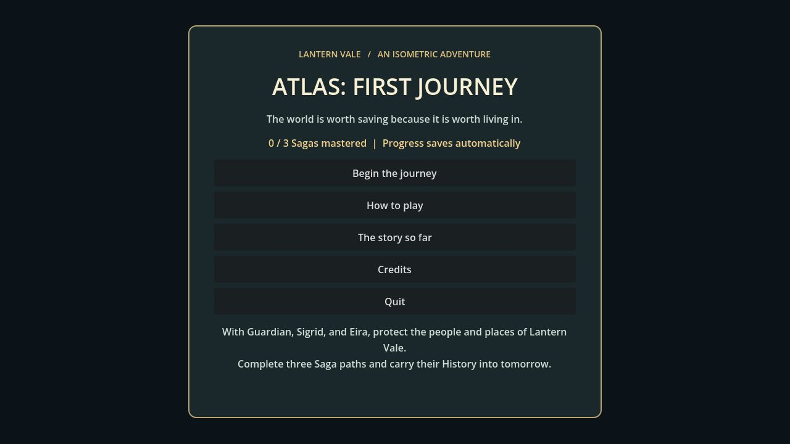
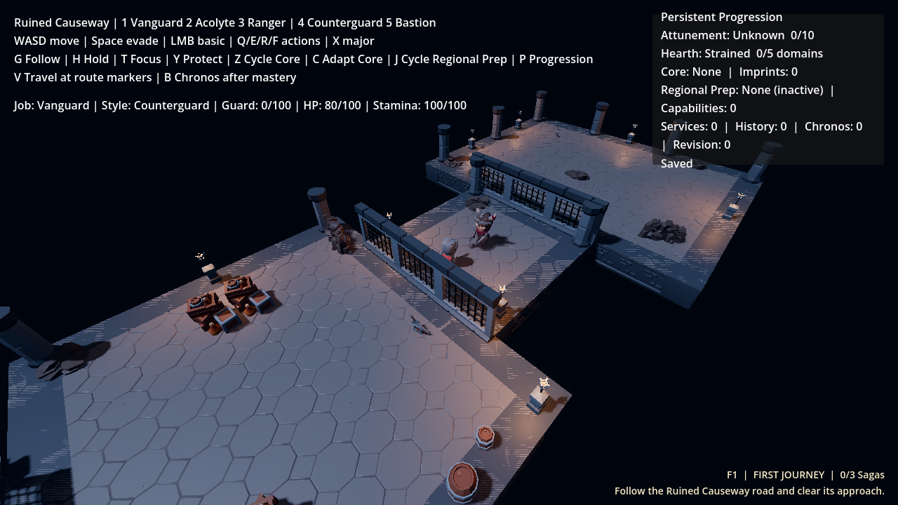
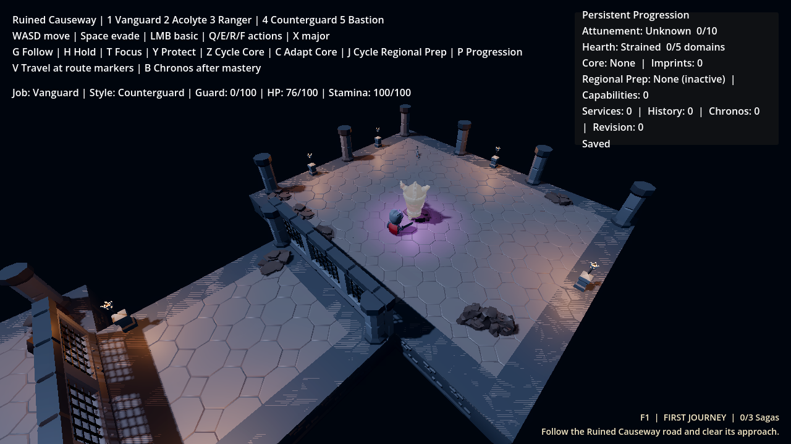
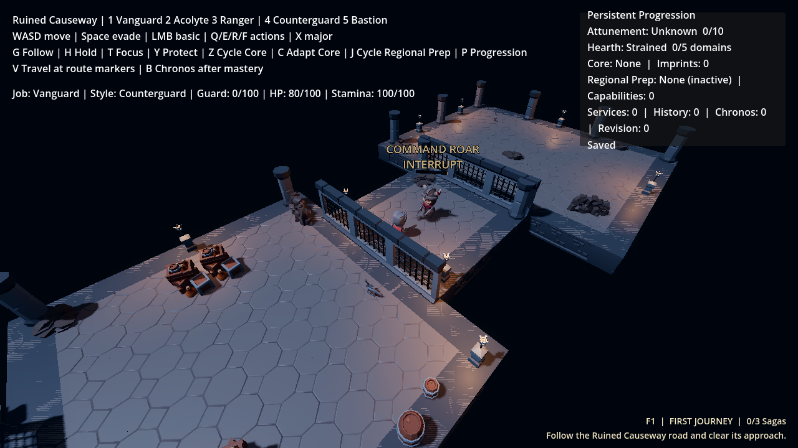

# Atlas Midgard and cross-engine transfer: experience-driven development v3

**Date:** 2026-11-27
**Status:** The Atlas combat-readability candidate is draft PR #93 and is not merged. The OhMyGame product code is unchanged; this record and the Episode 13 receipt are the durable OhMyGame changes. The preserved Superhero-Netorare-Parody candidates #355, #363 and #364 remain draft and were not modified.

**OhMyGame:** `ThorStarlord/ohmygame`, `dev` `b8c0252ae6a3e96b2228e68d3ca1b5063890a949`; prior product work is PR #19 (targeted live entry), #20/#21 (v2 pilot and reconciliation).
**Atlas Midgard:** `ThorStarlord/atlas-midgard`, baseline `main` `5aab42d03b16cb8467822f195a45daedb33c42cc`; candidate `feat/causeway-cast-visibility` at `2e8d6e815fea5f22e6252d66b4b5e4cd730eabde`, draft PR #93.
**Preserved game candidates:** #355 `e84b6122...`; #363 `23b7f084...`; #364 `270150dc...`. They are outside this mission and unchanged.

## Verified Sensemaking toolchain

The previous episode reported a local Sensemaking checkout behind `origin/main` with unrelated modifications. That remained true and had advanced:

- owner checkout: `9ae5338b9f5be80cec3af02b7fed30965b7a7503`, behind `origin/main` by 393 commits, with four unrelated modified documents;
- clean task worktree: `H:\GithubRepositories\sensemaking-v3` at `a6291c2d4815dec585526e3f21f142375169b98c`;
- clean receipt validator: `scripts/validate-receipt.py` present and passing the v2 receipt;
- installed harness Skill: `C:\Users\Admin\.agents\skills\using-sensemaking`, SKILL.md length 57,757, SHA-256 `6321125EACC6B61867101674EBA2253EBED278076B07B2BEA0467FAA08A3B014`;
- clean origin/main SKILL.md SHA-256 `60E7E9FCD794FF26E1C458E8AD88E062C2BA7F207606DBBB235339ACD551BD7A`; the stale checkout's is `62BD38D2F7522E0E14EF7BFF6678125B12C964F7374DA4A2F26AEEAD2AF8C529`.

The installed copy is neither the clean source nor the stale checkout. Its exact revision is not established. I did not overwrite it. The harness loaded that copy; the clean worktree was used for the receipt contract, validator and current-schema checks. This is a manual/explicit clean-source toolchain with a harness fallback, not a verified single-revision installation.

Historical receipts: the v2 receipt validates under the current validator; the two older OhMyGame receipts still fail the evolved schema. I did not rewrite or migrate them. The v2 receipt is the valid predecessor; its Q-4 (which Godot primitives a real Atlas exercise needs) is answered here. No supported migration tool was used or invented.

## Selected responsibility and intended experience

The selected scene is the **Ruined Causeway**, Atlas's first fully dressed Saga. The relevant encounter lesson is the Elite Gate Chain Warden and the Boss Hall Riftbound Castellan:

- Chain Warden: Hook Line, Crushing Sweep, and the 1.5 s interruptible **Command Roar**;
- Castellan: Heavy Line, Fracture Brand, the 1.8 s interruptible **Rupture**, and a 4 s, 1.5x damage vulnerability window after a Rupture interrupt or Stability break.

Intended experience:

> The player should recognize an enemy's special action, understand that it is interruptible, choose a response, and perceive whether the interrupt succeeded and what changed. The information should support deliberate tactical play without turning the fight into UI-watching or erasing legitimate difficulty.

Explicit commitments, not slogans:

- `docs/vertical-slice/combat-grammar.md:65-78` requires a **cast marker - interruptible action**.
- `docs/vision/player-experience-identity.md:42-56` lists active cast/interrupt opportunity as immediate combat information.
- `docs/implementation/package-10-player-facing-responsibility-completion.md:98-113` claims **interruptible-cast visibility** as a shared primitive.
- `docs/implementation/package-6-boss-synthesis.md:21-48` defines Rupture and its vulnerability window.

The simulation already had the cast state, telemetry and vulnerability multiplier. It had no player-facing cast marker. The generic attack animation and a brief hit flash were the only presentation.

## Entry and runtime path

The strongest **OhMyGame-managed** path is the Godot web export played through the app's browser `game_use`:

- the official preinstalled plugin is still `ohmygame/godot` `1.0.3`;
- its manifest has no `gameUse`, no managed native game session and no viewport capture;
- `run-in-godot` launches the **editor**, not the game, and still lacks managed-session ownership;
- npm and upstream remain at 1.0.3; the contributor changes that add editor lifetime and the Web-preset `include_filter` are open upstream, not released;
- the app's `game_use` does open the Atlas Web build and provides real pointer/keyboard input and screenshots.

Actual app-managed evidence: title → Begin → Ruined Causeway → W/D movement at 1280x720, with zero page console errors. This is WebGL web fidelity, not native Godot, and did not reach combat.

Native engine evidence used the pinned Godot `4.7.2.stable.official.ed1daf0bf` executable at `H:\GithubRepositories\atlas-midgard\.tools\godot\4.7.2`. The project probes start the real `EliteDirector`/`BossDirector`, disable companions only to let the cast occur, and write `user://` captures under a disposable `APPDATA`. This is direct SDK/project-test execution, not OhMyGame-managed native play. The `--script` path uses disposable test profiles; no canonical player profile was written.

## Before observations

The baseline Warden probe reached the Command Roar frame 441 after starting `pack.elite`. The viewport showed the Warden and the generic attack animation, but no cast name, interrupt cue or progress. The Castellan probe reached Rupture frame 403; after a deterministic interrupt, the 4 s vulnerability was invisible except for the brief white hit flash.

Source-level context:

- `is_interruptible_cast_active()` and `enemy_cast_*` telemetry exist;
- `ActorVisual` only plays a generic attack animation on `action_started`;
- the Castellan's vulnerability is a damage multiplier with no presentation path;
- the combat HUD is the debug player-stat line plus the progression panel; there is no enemy cast/status strip.

## Opportunities considered

1. **Cast and vulnerability markers only** — selected. It realizes the explicit cast-marker commitment and makes the existing interrupt/vulnerability loop legible without changing combat.
2. **Full combat HUD** (enemy health/Stability, statuses, party health, cooldowns, ability errors) — deferred. It is larger and would alter the information economy before the focused cue is evaluated.
3. **Encounter pack redesign** — not selected. The elite Command Roar's only effect is to empower nearby Reavers, and `pack.elite` contains only the Warden; this is a real encounter-content issue, but changing composition is a separate design decision.
4. **Managed native Godot game session in OhMyGame** — not selected. The Web path plus project-owned native probes provided the evidence; a native game session would be a larger product capability without a demonstrated blocker for this responsibility.
5. **Full Godot `game_use` parity** — rejected. It would generalize mechanisms before a real requirement justifies them.

## Implemented Atlas candidate

Draft PR #93, current head `2e8d6e8` (code/test reviewed at `6a28f64`; doc coverage note at `2e8d6e8`; initial code `a0b4f7df`):

- `game/scripts/visual/cast_telegraph.gd`: a presentation-only world-space label, `INTERRUPT` line, progress bar, and result text.
- `ActorVisual`: creates the marker for actors exposing an interruptible cast, polls cast/vulnerability state, and shows `INTERRUPTED` / `CAST COMPLETE`.
- `PrototypeEnemyActor`: exposes cast name/progress for Command Roar, Null Chorus and Excess Harvest; emits `cast_interrupted` / `cast_completed`.
- `RiftboundCastellan`: exposes Rupture and the 4 s vulnerability remaining/duration; interrupting Rupture or breaking Stability shows `VULNERABLE` with the live countdown.
- `tests/smoke_causeway_cast_telegraph.gd`: checks the Warden cast/interrupt and Castellan vulnerability; registered in `verify.ps1`/`verify.sh`.
- `tests/causeway_elite_probe.gd` and `tests/causeway_boss_probe.gd`: windowed disposable-state capture probes.
- `docs/implementation/causeway-cast-visibility.md` and six before/after images.

No damage, cast duration, cooldown, AI target, Stability rule, vulnerability multiplier, encounter pack, progression state or save format changed.

## After observations and evaluation

The same Warden probe now shows:

**Warden caveat:** this is a timing/state cue only. `pack.elite` contains no eligible Reaver for Command Roar to empower; the Castellan is the meaningful consequence showcase.

The Castellan probe now shows:

### Technical

- `smoke_causeway_cast_telegraph.gd` passes (exit 0) for both actors.
- `playthrough_first_journey.gd` still prints `FIRST_JOURNEY_PLAYTHROUGH_OK`: 3/3 Sagas, zero defeats.
- `smoke_combat_runtime.gd` and `smoke_first_playable_scene.gd` exit 0 when run directly; both emit pre-existing ObjectDB/teardown warnings.
- The full `verify.ps1` was attempted on the exact commit. After clearing an ignored stale `.godot` cache, it stopped at the unchanged `smoke_combat_runtime` because its pre-existing ObjectDB warning is raised as a PowerShell terminating error under `$ErrorActionPreference = "Stop"`. This is not a candidate regression; the focused tests above pass.
- The candidate was not merged, and no canonical player profile or save was used.

### Perceptual

- At 1280x720 the Warden label reads `COMMAND ROAR / INTERRUPT` with an amber bar; the interrupted result reads `INTERRUPTED`.
- The Castellan reads `RUPTURE / INTERRUPT`; after the interrupt the marker reads `VULNERABLE / 4.0s` with a draining bar.
- The marker is a no-depth-test billboard; it can overlap walls/other characters and has not been judged in motion or at other aspect ratios.
- The elite's Command Roar still has no eligible Reaver to empower. The marker makes the cast and the interrupt timing visible, but the encounter's intended empowerment consequence remains absent.

### Experiential

The cue makes the explicit cast/interrupt opportunity perceptible and gives the boss vulnerability a visible window. It supports the tactical objective without changing difficulty. It does not establish that a human player will read, trust or respond to the cue; no human playthrough or motion study was performed. The Warden's no-consequence roar may make a correct interrupt feel inconsequential even with the result flash.

### Independent review

The first independent review said **revise before merge, not reject**. It found two high-severity execution problems and three supporting gaps: the bar overlapped the `INTERRUPT` text; the Castellan's `INTERRUPTED` result was immediately replaced by `VULNERABLE`; an active Rupture was hidden if Stability opened vulnerability; the test only checked that the fill was non-zero; and the Warden showcase implied a consequence the elite pack does not have.

The candidate was revised before retention:

- the gauge now sits below the label and is taller, with a distinct mint vulnerability color;
- an active cast takes priority over vulnerability, so Stability cannot hide Rupture;
- the Castellan's result is the `VULNERABLE` window; the Warden still shows `INTERRUPTED`;
- the test now proves fill growth, both Warden results, active-cast priority, vulnerability, and expiry;
- the Warden frame is explicitly a timing/state cue, and the change is scoped to Causeway `ActorVisual` actors.

The review chain is recorded honestly: the initial review requested revisions; a second review accepted with a gauge-alignment limitation; a third found the fill still behind the track; after moving the fill to the camera-facing side with higher render priority, the final review accepted the draft with named limitations. The test now asserts fill order and vulnerable completion. No human or motion study is claimed.

## Cross-engine transfer assessment

| Capability / method | Ren'Py episode | Atlas v3 | Classification |
|---|---|---|---|
| Context-targeted entry | `game_use open start:<label>`; engine-validated label | No native Godot equivalent; Web starts at title; project probe starts packs directly | Shared responsibility, different implementations; native Godot not demonstrated |
| Isolated execution | Copied project, throwaway savedir/persistent | Web preview; native `--script` test profiles and disposable APPDATA | Reusable with engine-specific adaptation |
| Structured state inspection | Dialogue, choices, screens, interaction id | Web `game_use` sees DOM/canvas only; native probes/telemetry see game state | Concept transfers; Godot native inspection missing |
| Interactive actions | Semantic advance/choose | Web pointer/keyboard moved the character; Electron logged keycode-converter warnings for lowercase w/d; native agent input unavailable | Web reusable but keyboard mapping not formally qualified; native engine-specific gap |
| Reproducible scenarios | Ren'Py testcases and checkpoints | Project `smoke_*.gd`, input-driven playthrough, native probes | Methodology transfers; implementation engine-specific |
| Visual observation | Engine-rendered frames through plugin | Web canvas captures; native direct viewport captures | Reusable with engine-specific integration |
| Evidence retention/comparison | Checkpoints, hashes, before/after | Web captures + native PNGs + telemetry; manual comparison | Shared method, not a common product surface |
| Adaptive investigation | Live state-dependent advance/choose | Web movement only; combat reached by native probe | Partially demonstrated |
| Agent knowledge continuity | Receipts/pilot, manual retrieval | Same; installed Skill provenance unresolved | Not automatically demonstrated |
| `game_use` plugin architecture | Ren'Py declares it | Official Godot 1.0.3 does not | Engine-specific plugin gap |
| Start-label contract | Ren'Py label | Not directly reusable; Godot needs scene/context semantics | Engine-specific; do not copy blindly |

The transferable asset is the **method**: choose a real responsibility, establish intended experience, reach meaningful context, inspect actual state, act, observe, retain evidence, and evaluate against intent. The engine mechanisms are not interchangeable.

## Development-cost observations

- The Atlas Web preview build took about 40 seconds in this run (from the preview log, not a controlled benchmark); the first two `game_use.open` calls were superseded while the build was still starting, and the retry succeeded once `preview.status` was `ready`.
- The native Warden and Castellan probes each completed in a bounded run with `--fixed-fps 60`; they are direct engine runs, not app-managed sessions.
- The full Atlas verifier was more expensive than the targeted path and was blocked by an inherited warning behavior; targeted smoke + playthrough gave the relevant evidence.
- No model/tool cost comparison or human-coordination measurement is claimed.

## Sensemaking Beneficiary Experience - Episode 13

The repository still has no numbered episode ledger. This is Episode 13 by the owner's series, linked to the v2 session; it does not claim an automatic ledger or automatic continuity.

**What prior understanding was sought.** The v2 receipt and pilot, especially Q-4 about the Godot primitives a real exercise needs; the cross-engine pilot; the Godot managed-session qualification; the package 1/6/10 combat contracts; and the v2 lesson about location versus gameplay context.

**How it was recovered.** Explicit reads of the OhMyGame pilot/receipt files and ordinary Atlas repository inspection. The harness-loaded Skill was used for the method, but the clean `sensemaking-v3` worktree was used for the receipt contract and validator. No semantic index, grounding pack or automatic cross-session surfacing was available. This is manual retrieval, not automatic continuity.

**Provenance and applicability.** The v2 receipt validates under the current validator and is the applicable predecessor; the older receipts do not. The v2 pilot's Godot question was directly applicable. The cross-engine pilot's web evidence was applicable to the app-managed path, but it had not reached combat, so it could not be treated as combat evidence.

**Which consequential decisions it influenced.** The v2 lesson that a location does not establish context led to separating the Web title/Causeway/movement observation from the native Elite/Boss probes. The lesson that engine success does not establish player-facing correctness led to inspecting the actual cast frames rather than treating `is_interruptible_cast_active` or telemetry as sufficient. The product/consumer separation kept the Atlas candidate out of OhMyGame and preserved the game candidates. The prior Godot limitation evidence prevented treating `run-in-godot` as gameplay.

**Lessons applied, adapted or rejected.** Applied: use actual engine evidence; preserve difficulty; keep product and game changes separate; distinguish direct SDK from app-managed execution. Adapted: the Ren'Py start-label idea became “reach meaningful context” via Web entry plus native project probes, not a copied Godot API. Rejected: full Godot parity, a managed native game session for this mission, and broad HUD redesign.

**What new knowledge was preserved.** The official Godot 1.0.3 capability boundary; the Web `game_use` path for Atlas title/Causeway/movement; the native probe and `--script` isolation path; the cast/vulnerability presentation gap; the elite Command Roar no-Reaver issue; the cross-engine transfer table; the candidate and its limits.

**Where Sensemaking was insufficient.** The installed Skill's exact revision is unresolved; the clean source had to be used manually. Older receipts are invalid under the current schema. There is no automatic knowledge retrieval or continuity. No comparative cognitive improvement is claimed; a general lesson restated in another repository is not evidence of cross-domain learning.

**What ordinary engineering and creative reasoning accomplished independently.** The Atlas encounter inspection, the decision to realize the existing cast-marker commitment, the UI composition, the source/test implementation, and the evaluation against the tactical objective.

## Remaining limitations

- The Atlas candidate is a draft PR, not merged; no human or motion-based readability study; no audio.
- The elite Command Roar has no eligible Reaver; the intended consequence is absent. The marker can make a successful interrupt feel less meaningful.
- The candidate's Web build was not re-exported with the marker; the Web path is baseline evidence, while the after frames are native direct-engine evidence.
- The Web `game_use` keyboard path produced Electron keycode-converter warnings for lowercase `w`/`d`. Movement was observed in the captures, but the key mapping is not formally qualified; this is an interaction/product limitation, not a proven failure.
- The official Godot plugin has no native `game_use`, managed game session or viewport capture; upstream editor-lifetime and preset PRs remain open and unreleased.
- The full Atlas verifier is blocked by a pre-existing ObjectDB warning under Windows PowerShell; targeted tests and the playthrough pass.
- The marker uses no-depth-test, fixed world-size billboards and needs motion/aspect-ratio review. It covers Causeway `ActorVisual` actors; the Silent Archive Herald and Hunger Regent special scenes are not covered.
- The gauge fills right-to-left in the current camera orientation. It is readable, but the opposite of the usual left-to-right convention; minor polish, not a blocker.
- The Sensemaking installed Skill revision is unverified; older receipts remain immutable but invalid; no automatic continuity.
- The OhMyGame product code is unchanged; the browser path and native probe path are existing capabilities, not a new cross-engine navigation layer.

## Next warranted responsibility

The strongest next **game-development** responsibility is a bounded Atlas encounter-design review of the Elite Command Roar: decide whether the Warden should have an eligible Reaver or a different observable consequence, without weakening the interrupt lesson. If future work genuinely needs first-class native live observation, scope a managed Godot **run-game** session separately; do not build full Godot `game_use` parity or a universal scene/state API from this one exercise.

The Atlas candidate remains a preserved draft. No further Superhero-Netorare-Parody development is included.
