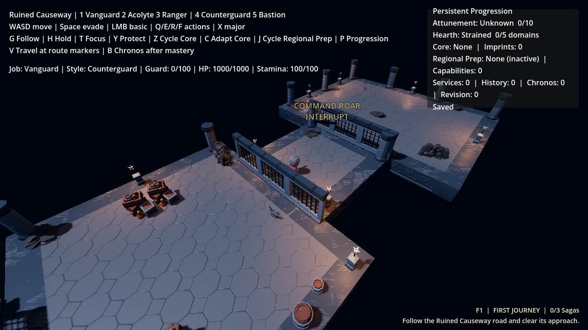
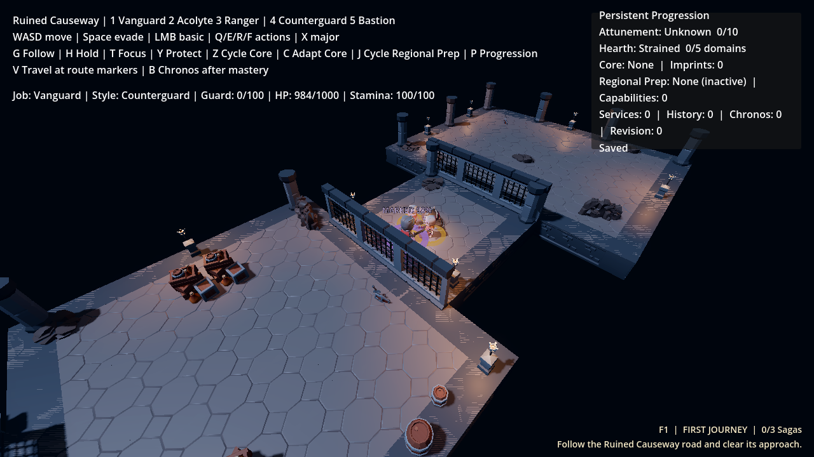
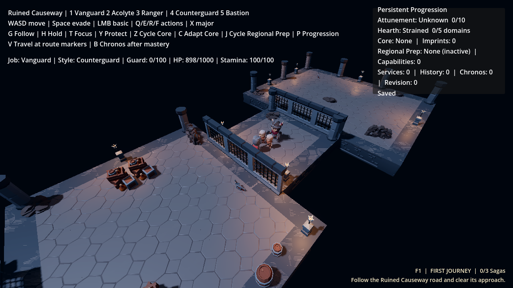
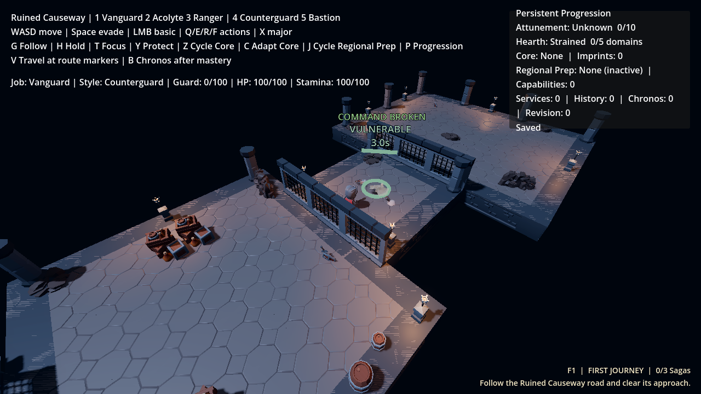
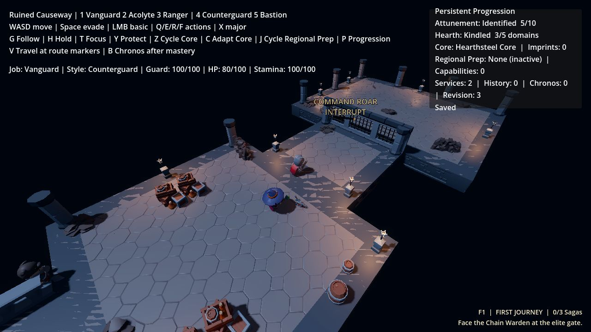
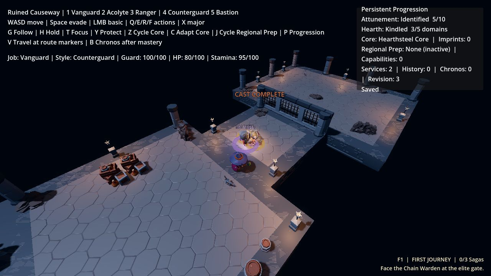
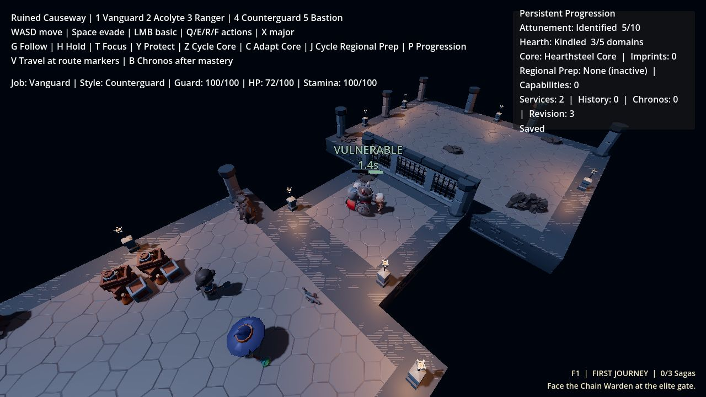

# Atlas Chain Warden tactical encounter: autonomous feature development v1

**Date:** 2026-11-27
**Status:** Atlas candidate revised after four independent reviews and
reviewable as draft PR #94, stacked on cast-visibility draft PR #93; not
merged. The candidate is not human-playtested or merge-ready. The
app-managed Web run used the pre-revision build; the revised behavior is
carried by the native probes, tests and the full journey.

**OhMyGame:** `ThorStarlord/ohmygame`, `dev` from
`6e47ed154965866bf8d9c4a9db48550bdcfa4e6b`; the source-grounded,
owner-merged Godot semantic pack is at `dbf985cf...`, with a follow-up
platform-`gameUse` claim.
**Atlas Midgard:** canonical `main`
`5aab42d03b16cb8467822f195a45daedb33c42cc`; cast-visibility draft #93 at
`2e8d6e8`; the encounter candidate `feat/chain-warden-command-roar` (PR #94).
**Preserved game candidates:** #355 `e84b6122...`, #363 `23b7f084...`, #364
`270150dc...`; unchanged.

## Delegated intention

Develop the Ruined Causeway's Chain Warden into a coherent tactical encounter
in which **Command Roar** is a readable, consequential, counterable and
recoverable threat, preserving Atlas's "hardcore depth without hardcore
stress" identity.

## Verified Sensemaking toolchain

- owner checkout `9ae5338b...`, 393 commits behind `origin/main`, four
  unrelated modified documents; preserved untouched;
- clean task worktree `H:\GithubRepositories\sensemaking-v3` at
  `a6291c2d4815dec585526e3f21f142375169b98c`;
- pinned executable via isolated `uv tool run --from
  git+https://github.com/ThorStarlord/sensemaking-skills.git@a6291c2d...`;
- harness-loaded Skill copy `6321125E...`; exact source revision unresolved;
  the clean source supplied the schemas, validator and CLI.

The v3 and v2 receipts validate; the two older OhMyGame receipts remain
immutable but invalid. No migration or fabricated evidence.

## Semantic preservation-retrieval-application loop

### Preservation

A source-grounded OhMyGame knowledge pack
(`.sensemaking/knowledge/godot-development.json`) was merged in PR #23 at
`dbf985cf`. It is **owner-merged, not independently reviewed**; the
proposal check is schema/path validation, not truth (`authority_verified:
false`, `semantic_truth_established: false`). The original claims:

- `cap:godot-web-game-use`;
- `constraint:godot-plugin-native-game-gap`;
- `lesson:godot-evidence-layers`.

A follow-up claim, `cap:plugin-native-game-use`, was added after the
Sensemaking review: OhMyGame's plugin contract supports a
contributor-declared native `gameUse` with inspect/act/capture; the pinned
Godot 1.0.3 plugin does not declare it.

### Retrieval by a separate context

A separate agent context was asked the evidence question and ran the pinned
`knowledge-query`; it was not given the claim statements, but its prompt
named the Godot/Web/native axes. Independence is therefore **bounded**, not a
controlled blind trial. It reported:

- search `Godot`, `game_use`, `native`, `Web`: 19 hits including the three
  substantive claims;
- `explain lesson:godot-evidence-layers`: 3 claims and two relations;
- `context-for` the v3 pilot: two relevance candidates
  (`constraint:godot-plugin-native-game-gap`,
  `lesson:godot-evidence-layers`) that were **CANDIDATES_NOT_ESTABLISHED**;
  all context categories `NOT_ASSESSED`;
- coverage gaps: no Atlas content; `run_headless`/MCP evidence limits not
  modeled; the platform native `gameUse` nuance not modeled.

### Application

The retrieval **confirmed and articulated** the evidence plan; it did not
change it. The v3 pilot already stated the Web/native split, and the native
probes ran before the query. The prior v3 understanding, recovered by
ordinary document reads, did influence the decisions:

- “a location is not gameplay context” led to the baseline elite-pack
  investigation rather than treating the Web Causeway entry as combat;
- “engine success is not player-facing correctness” led to rendered
  frames and the actual mark/aura checks rather than trusting cast state;
- product/consumer separation kept the encounter in Atlas and the durable
  record in OhMyGame.

The semantic retrieval is explicit, not automatic; it did not supply the
encounter design. The installed Skill’s exact revision remains unresolved.

## Baseline evidence

- `pack.elite` was `[CHAIN_WARDEN]`; Command Roar only empowered nearby
  Reavers; there was no eligible Reaver.
- The full journey killed the 260-HP Warden in 151 physics ticks (about
  2.5 s), with no `enemy_cast_*` events.
- The Ranger companion auto-interrupts casts; the first candidate’s full
  journey let the companion interrupt the opening roar at tick 886, so no
  `enemy_command_mark` occurred.

## Design selection

The independent design exploration compared pre-spawned Reavers, a solo pulse,
a Warden/support, and a one-time Muster with a command mark. The pre-spawned
Reavers die before the first roar and change the pack surface; the pulse
overlaps other identities; the support crowds the gate. The selected design:
the opening Command Roar musters the pack, a completed command marks the
weakest ally and focuses the pack, an interrupt opens a vulnerability, and a
scoped companion grace covers later commands.

## The implemented encounter

- The Warden opens with Command Roar (1.5 s, interruptible). The first cast
  musters two Reavers at the Warden's flanks. The opening command is the
  player's; `interrupt_grace_progress()` returns 1.0 for it.
- A completed roar marks the ally with the lowest current/max health ratio
  (tie-break farthest) for 6 s. The Warden and Reavers within 8 m target that
  ally for 6 s; the Reavers gain the existing 1.35x empower for 6 s.
- The mark label shows the ally's health fraction (`MARKED 62%`); the purple
  ring/light follows the ally; dead targets clear the mark and forced threat.
- An interrupted roar prevents the command and opens 3 s / 1.5x vulnerability
  with a real 2.0 s action pause; the result is `COMMAND BROKEN`.
- Later commands return a 60% companion grace; the player gets the first
  window and the companion covers if the player does not.
- `CAST COMPLETE` is suppressed when the command marks; the mark is the
  consequence. The cast has an amber ground ring, a larger bar and a 60%
  grace notch; the vulnerability has a mint ground ring.
- The Warden has 420 health; `pack.elite` remains `[CHAIN_WARDEN]`. The Muster
  is once-only; later roars refresh the command on the existing pack.

## Actual engine evidence

Uninterrupted command (native, companions disabled):

- `MARK_TARGET=Player`;
- `MARK_REMAINING=5.83`;
- `EMPOWERED_REAVERS=2`;
- `MARK_AFTER=true` after the window;
- the mark label shows `MARKED 98%` in that probe.

Interrupted command:

The revised full input-driven journey:

- `FIRST_JOURNEY_PLAYTHROUGH_OK`, 3/3 Sagas, zero defeats;
- elite ticks 815-1094 (about 4.65 s);
- `enemy_muster` and `enemy_reinforcements_spawned` at tick 815;
- `enemy_command_mark` at tick 906 with `target_id: Player`,
  `empowered: 2`; `enemy_cast_completed` at tick 906;
- the encounter completes at tick 1094.

The focused tests:

- `CAUSEWAY_CAST_TELEGRAPH_OK`;
- `RESPONSIBILITY_SEMANTICS_SMOKE_OK`;
- `ENCOUNTER_SMOKE_OK`;
- `CAUSEWAY_WARDEN_ENCOUNTER_OK`, including
  `REAL_SCENE_MUSTER_OK mark=Player empowered_reavers=2` and
  `REAL_SCENE_COMPLETION_OK`;
- `FIRST_JOURNEY_PLAYTHROUGH_OK`.

## App-managed Web evidence

The first app-managed attempt failed because the workspace lacked its
`ohmygame.json` project marker; restoring it let the app's plugin build and
serve the export. The app agent clicked Begin, cleared the approach, bridge
and courtyard, and reached the Elite Gate with delivered pointer/keyboard
input. It captured the opening amber cast and the completed `MARKED` player
with gold auras:

A first run's Shield Bash did not stop the command; the command completed and
the mark/auras appeared. A second run closed to melee and **successfully
interrupted** the opening Command Roar with Shield Bash; the mint
`VULNERABLE` bar was captured (about 2.9 s), the command was prevented, and
no mark/aura appeared:

Both outcomes were therefore exercised through the app-managed build. The
first failure's cause was not instrumented (range/timing/acquisition); there
is no ability-failure feedback. The second run proves the interrupt is
reachable with the same Vanguard controls, while the first shows the
positioning/timing cost. The preview bridge logged connection failures while
the game kept accepting input. The Web build predates the revised
opening-command/ratio/label changes; the native tests carry those. This is
Web fidelity, not native Godot or a human playthrough.

## Independent review and revisions

- **Design — revise.** The opening command was auto-covered in the full
  journey; the mark used absolute health and was invisible; the reward was
  disproportionate at bot speed; the Muster/gate presentation implied the
  pack was preventable; the grace did not restore agency; the transfer claim
  was unsupported.
- **UX — revise.** The caster was not locatable in the first frame; the bar
  was too small; the companion grace was invisible; the mark/gold cues merged;
  the `COMMAND BROKEN`/vulnerability labels overlapped; the vulnerable body
  was not a target; the “hunt” frame duplicated the mark frame.
- **Engineering — revise.** Dead marked targets were still forced; the
  Muster latch/telemetry/fallback were wrong; vulnerability refresh used
  assignment; core rules were untested; the docs were uncommitted (stale
  finding; the docs commit followed); the “no damage/cooldown change”
  statement was false.
- **Sensemaking — accept the loop with limits.** The pack is not
  independently reviewed; the fresh context is bounded; the retrieval
  confirmed rather than changed the plan; the query receipt misrecorded
  `context-for`; the platform nuance was unmodeled.

Revisions made:

- the opening command is the player's; the companion covers later commands;
  the full journey now records the mark;
- the mark uses the lowest ratio with a farthest tie-break and a visible
  fraction; tested with a nearer decoy; healing during the cast retargets;
- the interrupt pause is 2.0 s; vulnerability refresh uses `maxf`;
- dead marks/threats clear; the mark node frees on target death;
- the Muster latch/telemetry/fallback are corrected; the Reavers spawn in
  view; the gate doc removed;
- the cast ground ring/bar/notch, `COMMAND BROKEN`/`RUPTURE BROKEN`, suppressed
  `CAST COMPLETE`, and mint vulnerability ring; the result label moved clear;
- tests cover the ratio/decoy, heal retarget, 1.5x, Muster once-only,
  completion accounting, the real trigger, and Vanguard/grace;
- the platform native `gameUse` claim was added to the OhMyGame pack; the
  pilot/receipt wording corrected.

Remaining review limits are recorded below; the candidate is not merge-ready.

## Cross-engine assessment

| Capability / method | Ren'Py evidence | Atlas / Godot v1 | Classification |
| --- | --- | --- | --- |
| Context-targeted entry | `game_use open start:<label>` | Web starts at title; native probe starts the pack | Shared responsibility, different implementations; native product not demonstrated |
| Managed execution | Copied project, throwaway saves | App-managed Web preview; direct native `--script` probes | Reusable with engine adaptation |
| Structured state inspection | Dialogue/choices/screens | Web DOM/canvas only; native probes read state | Concept transfers; native app-managed state missing |
| Interactive actions | Semantic advance/choose | App-managed pointer/keyboard; native probes not input-driven | Web reusable; native agent input missing |
| Reproducible scenarios | Ren'Py testcases/checkpoints | Atlas smokes, journey, probes | Methodology transfers |
| Visual observation | Engine frames through plugin | Web canvas captures; native direct renders | Reusable with integration |
| Evidence retention/comparison | Checkpoints/hashes | Web/native captures + telemetry | Shared method |
| Agent knowledge continuity | Receipts/pilot, manual | Reviewed semantic retrieval (explicit/bounded) | Explicit retrieval demonstrated; automatic continuity not |
| `game_use` plugin architecture | Ren'Py declares it | Pinned Godot 1.0.3 does not; platform supports if declared | Engine-specific plugin gap |
| Start-label contract | Ren'Py label | Not reusable; Godot needs scene/pack/context semantics | Engine-specific |

The transferable asset is the **method**: preserve reviewed understanding,
retrieve it explicitly, assess its scope, apply/confirm it, construct the
feature, exercise it with the strongest engine path, and retain the claim
ceiling. The engine mechanisms are not interchangeable.

### OhMyGame capability decision

No new OhMyGame product code was added. The app-managed Web `game_use` path
supplies browser input/observation; direct native probes supply engine
mechanics. A managed Godot **run-game** session would improve lifecycle and a
native window but would not remove the binding limitation without native
input and state. A narrow native `gameUse` adapter (managed process, input,
frame capture, bounded state) is the next product capability if native live
play becomes necessary; it is larger than this responsibility. The platform
contract supports it when a plugin declares it; the pinned 1.0.3 plugin does
not. This is a distribution boundary, not a fabricated app capability.

## Development costs

- The app-managed Web build was built and served after restoring the project
  marker; the first attempt failed before the title.
- The native probes are bounded windowed runs with `--fixed-fps 60`.
- The full journey is the dominant test cost; it passes with zero defeats.
- The semantic index build indexed 659 claims/653 relations at `dbf985cf`;
  the follow-up platform claim adds one claim/relation. The fresh query is
  fast but the index has only four substantive Godot claims.
- No controlled benchmark or human-coordination measurement is claimed.

## Sensemaking Beneficiary Experience - Episode 14

This is Episode 14 by the owner's series; the repository has no numbered
ledger or automatic continuity. It is not a claim of cognitive superiority.

**Prior understanding sought.** The v3 pilot/receipt and its Godot evidence
boundary; the managed-session qualification; the v2 location-versus-context
lesson; the v3 engine-success-versus-player-facing lesson; product/consumer
separation.

**Recovery.** The v3 documents were read explicitly. The reviewed semantic
pack was indexed and queried by a separate agent context; the query found the
claims and the two `context-for` candidates. The retrieval is explicit and
bounded; the index has no Atlas content. The installed Skill’s exact revision
remains unresolved; the clean source supplied the contracts.

**Provenance and applicability.** The pack is source-grounded and
owner-merged; the proposal check is not independent truth. The claims are
scoped to OhMyGame and cite the v3 pilot/config. The platform `gameUse` claim
is a follow-up; the Atlas encounter knowledge remains in the Atlas doc/pilot,
not the OhMyGame index.

**Consequential decisions influenced.** The prior v3 lessons influenced the
baseline elite-pack investigation, the rendered before/after evidence, and
the product/consumer separation. The semantic retrieval confirmed the
native/Web evidence split and the claim ceiling; it did **not** change the
design. No causal plan change is claimed.

**Lessons applied, adapted or rejected.** Applied: actual engine evidence;
preserve difficulty; separate product/game; distinguish app-managed Web from
direct native. Adapted: targeted entry became a project-owned native probe
plus the app-managed Web route. Rejected: a managed run-game session as the
immediate fix; full native parity; broad HUD redesign.

**New knowledge preserved.** The Warden’s no-Reaver and 2.5 s/no-cast
baseline; the Muster/mark/focus/vulnerability/grace design; the revised
opening-command default; the mark ratio/fraction; the 4.65 s full journey with
the mark; the endgame metadata-only note; the platform native `gameUse`
nuance; the Web first-run completed command/mark and the second-run successful
interrupt.

**Insufficiency and counterevidence.** The pack has no Atlas content; the
fresh context was bounded; the retrieval confirmed rather than changed the
plan; the first Web build predates the revisions; the full verifier was not
cleanly completed; no human read the encounter. The companion auto-interrupt
covered the first candidate’s opening; the revised default fixes that, but
the companion-cover state is still not explicit.

**Ordinary reasoning.** The design exploration, the Muster adaptation, the
mark/grace/presentation implementation, the tests and the evidence were
ordinary engineering/creative work checked against engine behavior and four
independent reviews.

## Remaining limitations

- The Atlas candidate is a draft; no human playthrough, motion study or
  1280x720 field qualification. The bot’s 4.65 s is optimal fixed-fps input;
  the 3 s/1.5x reward and 6 s mark are not human-tuned.
- The `MARKED` label remains; the Ranger Marked Quarry vocabulary overlaps.
- The companion grace is 60% for later commands and absent on the opening;
  the first window/safety net need human tuning. The first Web Shield Bash
  failed and the second succeeded; the cause of the first failure was not
  instrumented, and there is no ability-failure/out-of-range feedback.
- The companion-cover state is only a 60% notch; focusing elsewhere silently
  disables it.
- The purple/gold rings can merge under the pack; the label and light carry
  the distinction; the vulnerable body has a mint ground ring, not a body
  outline.
- The mark/cast labels are no-depth-test and can overlap walls/HUD; the pack
  can clump; the mark ring can clip stairs/walls.
- The Warden’s Stability break has no vulnerability; only the interrupt opens
  the window.
- The Castellan’s Rupture is not covered by the Warden’s grace and is often
  skipped in the fast boss fight; the transfer is structural.
- The Endgame Interlocked Trial’s additional-enemy mapping is metadata-only;
  the global 420 health/Muster would apply wherever the Warden is
  instantiated; the endgame path needs review if it runs.
- Biomancer/Commander and other Jobs were not separately played.
- The app-managed Web run used the pre-revision build; the preview bridge
  logged connection failures; the first Shield Bash failed and the second
  succeeded.
- The full `verify.ps1` was not cleanly completed after the revisions; the
  v3 attempt was blocked by the inherited PowerShell/ObjectDB warning. The
  targeted tests and journey pass.
- The official Godot plugin 1.0.3 lacks native `gameUse`/managed game
  session/viewport capture; upstream fixes are open/unreleased.
- The installed Sensemaking Skill revision is unresolved; the index has four
  substantive Godot claims; older receipts remain invalid.

## Next warranted responsibility

The strongest next game-development responsibility is a human/motion
qualification of this encounter, especially the opening-command interrupt
window (0.9 s/later 60% notch), the `MARKED`/gold overlap, the companion-cover
state, and the ability-failure feedback. The Endgame Interlocked Trial
composition and the Castellan’s Rupture pacing should be reviewed separately.
A native `gameUse` adapter is a separate product responsibility only if live
native input/state becomes necessary; a run-game session alone is insufficient.

## Artifacts and revisions

- OhMyGame semantic pack: PR #23, `dbf985cf`; follow-up
  `cap:plugin-native-game-use` in the docs PR.
- OhMyGame pilot/receipts: this document, the Episode 14 session receipt, and
  the semantic query receipt.
- Atlas base: draft PR #93, `2e8d6e8`.
- Atlas encounter candidate: `feat/chain-warden-command-roar`, PR #94; code
  through `32b290f` plus the review-revision docs/evidence commit.
- Preserved game candidates: #355/#363/#364 unchanged.
